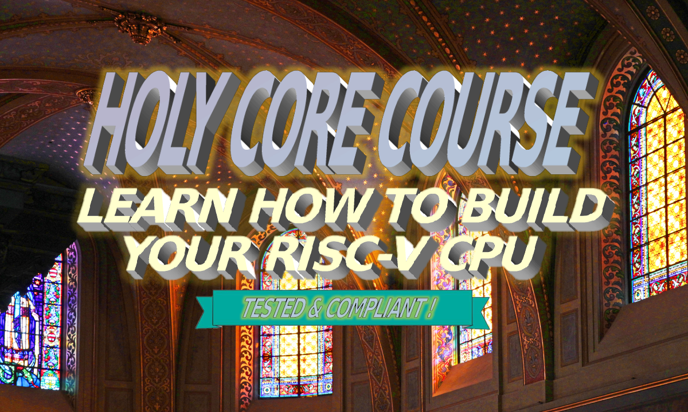

# HOLY CORE PROJECT

**Build your own 32-bit RISC-V CPU from scratch.** An FREE and open-source core with detailed tutorials. Some advanced material are indeed only accessible by paying (advanced verification, debug specs, traps, ...) but frankly, you have a loooot to dig and learn before getting there ;)

Wheteher you want to learn how to build your core using **REAL HANDWRITTEN** material or just have a simple and straightforward RV core to use in you projects, you are at the **right place**.

<!-- SIDE NOTE / DISCLAIMER This project is filled with catholic references. Because why not ;) BUT is not a substitute to the catholic church's preaching.-->

> [!NOTE]
> The **HOLY CORE** is a **handwritten** project.I'd say more than 90-95% of the code was written by hand. This is important as this is **NOT** antoher linkedin slop project or education slop. So hop on an adventure to learn from real people how to build your own CPU! And yes, the HOLY CORE runs [**DOOM**](https://github.com/0BAB1/HOLY_CORE_DOOM) ;)

## 🧙‍♂️ Choose Your Path

<table>
<tr>
<td width="50%" valign="top">

### 📚 I want to **LEARN**
*Follow the tutorials step-by-step*

Perfect if you want to understand how CPUs work by building the HOLY CORE yourself.

**Start here →** [Setup Guide](./setup.md)

Then follow the course:
1. [Single Cycle Edition](./0_single_cycle_edition/single_cycle_edition.md)
2. [FPGA Edition](./1_fpga_edition/fpga_edition.md)
3. [SoC & Software Edition](https://babinriby.gumroad.com/l/holy_core) *(PDF)*

</td>
<td width="50%" valign="top">

### 🚀 I want to **USE**
*Get the core running quickly*

Perfect if you already know what you're doing and just want to test/extend the core.

**Start here →** [Quickstart](https://0bab1.github.io/HOLY_CORE_COURSE/#quickstart)

Full reference docs:
- [📖 Documentation](https://0bab1.github.io/HOLY_CORE_COURSE/)

</td>
</tr>
</table>

## 🎓 What You'll Build

By the end of this course, you'll have:

| Feature | Description |
|---------|-------------|
| **RV32I Zicsr Core** | Full integer instruction set + CSR support |
| **Interrupts & Exceptions** | Privileged specs compliant |
| **Cache System** | Learn advanced state machines and AXI protocols by building configurable instruction & data caches |
| **Complete SoC** | UART, GPIO, etc Running on your FPGA, advanced tutorials even make you run DOOM ! |
| **Real Software** | C programs and bare-metal assembly thanks to the RISC-V open specs ! |

## 📖 Course Overview

### 🟢 Single Cycle Edition
> [!TIP]
> *Learn the fundamentals*

Build the full RV32I instruction set from scratch in SystemVerilog. Test everything with cocotb.

**You'll learn:** ALU design, register files, control logic, instruction decoding, (very) basic verification.

### 🟢 FPGA Edition  
> [!TIP]
> *Meet the real world*

Add memory interfaces (AXI), design a cache system, and deploy on actual FPGA hardware.

**You'll learn:** basic bug bug packed caches, bus protocols, FPGA implementation challenges.

> [!WARNING]
> *Note* : caches in this edition are pretty bad. I added them back then to have a basic interface woth the SoC that also explores cache and AXI basic but it is packed with bugs and extremely unefficient. You may skip it or explore your own solution there.

### 🟡 SoC & Software Edition *(Contributors Only)*
> [!TIP]
> *Make it useful*

Pass RISC-V compliance tests, add interrupts, write C code, build driver libraries.

Note that for now, it's only available here for the early supporters of the project or advanced people looking to take it a step further verification wise. See `## Support the Project` section.

**You'll learn:** Core verification, privileged architecture, interrupt handling, embedded C development, debug support.

### 🟡 Performance Edition *(Contributors Only)*
> [!TIP]
> *Maximise DOOM fps and overall perfs*

This edition is out for contributors. See `## Support the Project` section.

Note it may recieve further improvements later, especially if I need to pipeline the core.

### 🔴 Tapeout Edition *(Coming Soon + I'm too broke)*
> *Tapeout the HOLYCORE, one day maybe...*

But before doing that, I really need to better the core architecture to make the most of each piece of hardware, right now, it's not really efficient.

A 2-3 stage pipeline with some double issue capabilities + some OoO execution while performing memory operations (which can cost time, especially on uncached / caches misses) would not hurt. If not, simplifying the design to use less 

## 📊 Status

| Edition | Status |
|---------|--------|
| Single Cycle : base core | ✅ Complete |
| FPGA : implement and run on FPGA (but with lots of bugs) | ✅ Complete |
| SoC & Software : less bugs, full SoC, CSR and privileges support, traps, verification and C programs ! | ✅ Complete |
| Performance : Improve caches performances, fix caches bugs (lots of them lol) | ✅ Complete but can be improved |

## Support the Project

The code is **100% open-source** and always will be.

If you want to support the project and get nicely formatted PDF versions of the tutorials:

**→ [Get the PDF Course](https://babinriby.gumroad.com/l/holy_core)**

## 🤝 Contributing

Contributions are welcome! Typo fixes, documentation improvements, bug reports are all appreciated.

> [!WARNING]
>  Large architectural PRs have low chances of being merged. Open an issue first to discuss.

## 💪 Community Spotlight

- Check out [VERY HOLY CORE](https://github.com/jbeaurivage/very-holy-core) by @jbeaurivage: a Veryl rewrite of the HOLY_CORE! *Impressive, Very nice.*
- The HOLY CORE has been used **and cited** in a research paper ! [link](https://github.com/Peak-Embedded-Projects/RISCV-Research-Project/tree/main). Its simple yet verified design is useful to reasearchers looking to better isolate problems in complex systems !

## 📜 A Note on AI & Content

Please don't scrape this content to train AI models or rebrand it for LinkedIn clout. Thanks. 🙏

  <i>Happy learning! 🎓</i>

